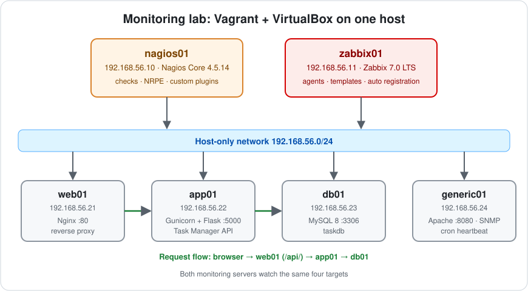
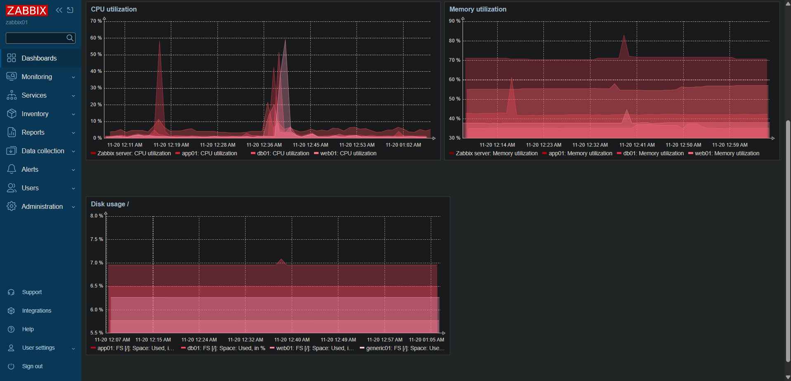

<h1 align="center">Enterprise Infrastructure Monitoring<br>with Nagios and Zabbix</h1>

<p align="center">
  
  
  
  
  
  
  
  
</p>

<p align="center">
  
</p>

A local lab that monitors a small multi-tier application with **two monitoring platforms side by side**:
**Nagios Core** (checks, NRPE, custom plugins) and **Zabbix** (agents, templates, auto registration,
custom items, triggers, actions and a capacity dashboard).

Everything runs on six Vagrant/VirtualBox VMs on one host-only network. The target application,
the monitoring servers and the failure scenarios are all reproducible.

**Highlights**

- Two monitoring stacks compared on the same infrastructure.
- Custom Nagios plugins (Bash and Python) and custom Zabbix items for application-level metrics.
- Zabbix auto registration, SNMP, MySQL and Nginx templates.
- Real failure scenarios with alerts, recovery and screenshots.
- Fully reproducible with Vagrant; every problem met along the way is documented.

**Contents:** [Architecture](#architecture) · [What is monitored](#what-is-monitored) · [How to run](#how-to-run) · [Failure scenarios](#failure-scenarios) · [Dashboards](#dashboards) · [Problems solved](#problems-found-and-solved) · [Layout](#repository-layout)

## Architecture

| VM | IP | Role | RAM |
|---|---|---|---|
| web01 | 192.168.56.21 | Nginx web server and reverse proxy | 512 MB |
| app01 | 192.168.56.22 | Flask API (Gunicorn), Task Manager | 512 MB |
| db01 | 192.168.56.23 | MySQL 8 | 1024 MB |
| generic01 | 192.168.56.24 | Generic Linux host: Apache (8080), SNMP, cron heartbeat | 512 MB |
| nagios01 | 192.168.56.10 | Nagios Core 4.5.14 (built from source) | 1536 MB |
| zabbix01 | 192.168.56.11 | Zabbix 7.0 LTS (MySQL + Apache + PHP) | 2048 MB |

Request flow: `browser -> web01 (Nginx :80) -> /api/ -> app01 (Gunicorn :5000) -> db01 (MySQL :3306)`

## What is monitored

### Nagios (`nagios/`)

- Agentless checks from nagios01 (PING, HTTP, API health, SNMP).
- **NRPE** on app01 and generic01 for local checks (load, disk, processes, file age).
- Two custom plugins written for this project:
  - `check_app_health.sh` (Bash): calls `/health`, maps HTTP 200 to OK and 503/connection error to CRITICAL.
  - `check_app_tasks.py` (Python): reads `/metrics-custom`, WARNING above 10 pending tasks, CRITICAL above 20.
- Host and service notifications by local mail.
- Full object definitions are in `nagios/config/`, plugins in `nagios/plugins/`, NRPE commands in `nagios/nrpe/`.

### Zabbix (`zabbix/`)

| Host | How it was added | What it uses |
|---|---|---|
| app01 | manual | Linux by Zabbix agent, ICMP Ping, custom items from the API (`UserParameter`) |
| db01 | manual | Linux by Zabbix agent, ICMP Ping, MySQL by Zabbix agent 2 |
| web01 | **auto registration** | Linux by Zabbix agent, ICMP Ping, Nginx by Zabbix agent |
| generic01 | **auto registration** | Linux by Zabbix agent, ICMP Ping, Linux by SNMP |

Also: triggers on the pending-tasks metric, a trigger action that logs problems and recoveries,
and a **Capacity Planning** dashboard (CPU, memory, disk of all hosts). Details in
[`zabbix/triggers-and-actions.md`](zabbix/triggers-and-actions.md).

## How to run

Requirements: VirtualBox, Vagrant, about 6.5 GB of free RAM to run every VM (the Nagios and Zabbix VMs can be started one at a time).

```bash
# 1. Target infrastructure (provisioned automatically)
vagrant up db01 app01 web01 generic01

# 2. Monitoring servers (bare VMs, installed manually)
vagrant up zabbix01      # follow docs/zabbix-setup.md
vagrant up nagios01      # Nagios Core 4.5.14 built from source, then copy nagios/ files in place
```

Quick check of the application:

```bash
curl http://192.168.56.21/api/tasks
curl http://192.168.56.22:5000/health
```

Zabbix UI: `http://192.168.56.11/zabbix`. Nagios UI: `http://192.168.56.10/nagios`.

## Failure scenarios

### 1. Stop Nginx on web01 (Zabbix)

```bash
vagrant ssh web01 -c "sudo systemctl stop nginx"
```

Zabbix raises `Nginx: Process is not running` (High) and the action writes it to the alert log:


After `sudo systemctl start nginx` the problem resolves by itself:


```
2026-11-19 22:45:26 High web01: Nginx: Process is not running [PROBLEM]
2026-11-19 22:52:26 High web01: Nginx: Process is not running [RESOLVED]
```

### 2. Task backlog above the threshold (Zabbix and Nagios)

Add more than 10 pending tasks through the API; the custom trigger `Task backlog high (pending > 10)` fires:

```bash
for i in $(seq 1 9); do curl -s -X POST -H 'Content-Type: application/json' -d '{"title":"load test"}' http://192.168.56.22:5000/tasks; done
```

The same threshold is applied by the Nagios plugin `check_app_tasks.py`.

## Dashboards




## Problems found and solved

| Problem | Cause | Fix |
|---|---|---|
| NRPE heartbeat check returned "File not found" | NRPE service runs with `PrivateTmp=true`, so `/var/tmp` is not the real one | Moved the file to `/var/lib/heartbeat` |
| Nagios would not start after adding services | Parentheses in service descriptions are illegal characters in Nagios object names | Renamed services (no `()=!$%^&*|'"<>?,`) and validated with `nagios -v` |
| Scripts failed on the VMs | Windows CRLF line endings | `.gitattributes` forcing LF for scripts and configs |
| VM would not boot (SSH reset) | Not enough RAM with all VMs running | Halt VMs that are not needed, start one monitoring server at a time |
| `apt install` blocked for minutes | `unattended-upgrades` held the dpkg lock after boot | Wait for it to finish (never kill it) |
| `zabbix_get` returned `Connection reset by peer` | Agent was running with the default `Server=127.0.0.1`, so it rejected the Zabbix server | Set `Server`, `ServerActive` and `Hostname`, restart the agent |
| Action script not executed | Script execution on the Zabbix server is disabled by default | `EnableGlobalScripts=1` in `zabbix_server.conf` |
| "System time is out of sync" trigger | VM clocks drift after halt/resume | Installed `chrony` on all VMs |
| Swap check CRITICAL on nagios01 | The VM has no swap | `check_swap -n ok` |

## Repository layout

```
.
├── Vagrantfile
├── apps/flask-api/        Flask API, schema, requirements
├── configs/               Nginx and systemd units
├── provision/             Provisioning scripts for the target VMs
├── nagios/                Nagios config, custom plugins, NRPE commands
├── zabbix/                Agent settings, SQL, triggers/actions, scripts
├── docs/                  Setup notes and screenshots
└── README.md
```

## Security note

This is a lab. Credentials in this repository (`taskuser`, `zbx_monitor`, SNMP community `monitor`)
are throwaway values, the Zabbix `Admin` password is left at its default, and server-side scripts are enabled.
Do not reuse any of this in production.
